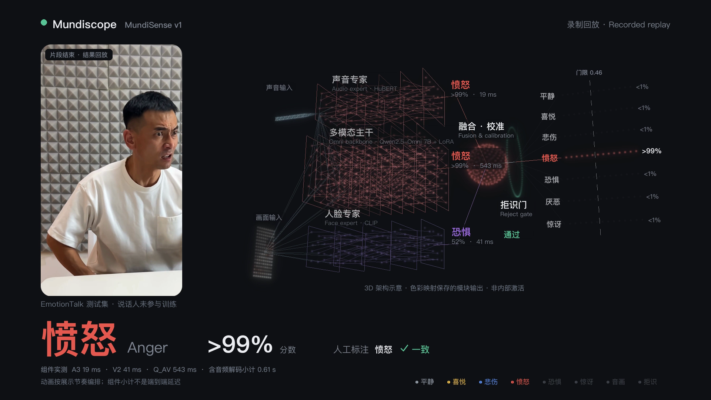
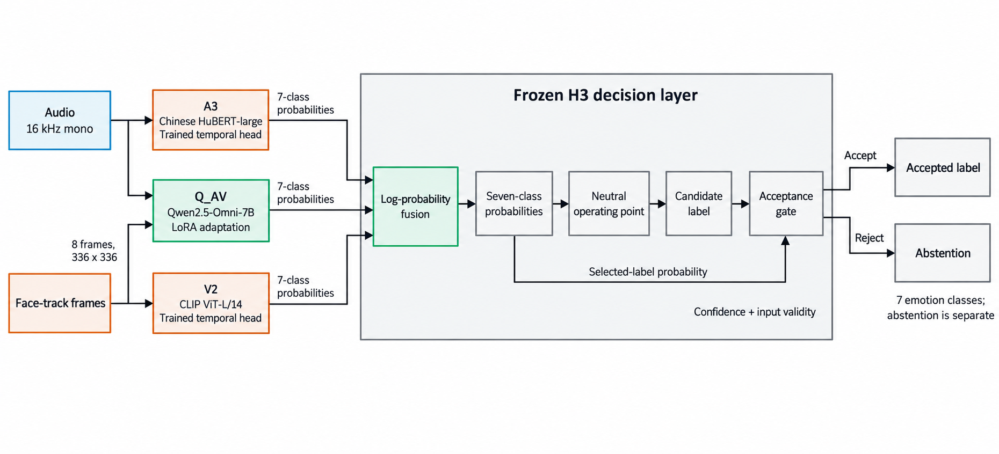

<div align="center">

# MundiSense v1

**Audio-visual emotion perception by Mundiscope · 洞悉尘世**

Voice, facial expression, and room for uncertainty.

[Project page](https://xpeng1999.github.io/MundiSense_v1/) · [Watch the demo](https://xpeng1999.github.io/MundiSense_v1/#demo) · [Technical report — PDF](docs/report/MundiSense_v1_Technical_Report.pdf) · [Read online](https://xpeng1999.github.io/MundiSense_v1/report/technical_report.html)

[](https://xpeng1999.github.io/MundiSense_v1/#demo)

</div>

MundiSense v1 is a research system for recognizing **observable emotional expression in Chinese speech and facial video**. It combines a task-adapted audio-visual model with audio and visual specialists, then applies frozen fusion, calibration, routing and abstention rules. It is Mundiscope's current **Sense** component in the broader **Sense → Remember → Express** direction.

The implementation retains the internal name `EmotionCore` and the Python namespace `emotioncore`. The public model name is **MundiSense v1**.

## Watch the system

The **1 min 44 s** film replays **eight selected, saved model examples** at 1080p / 30 fps, with original source audio: six EmotionTalk cases and two CH-SIMS v2 film clips. The latter show complementary audio-visual evidence and rejection when multiple faces make attribution ambiguous.

- [Full demo](https://xpeng1999.github.io/MundiSense_v1/#demo)
- [01:10 — Audio and video complement each other](https://xpeng1999.github.io/MundiSense_v1/?t=70.133#demo)
- [01:22 — Abstaining under multi-face ambiguity](https://xpeng1999.github.io/MundiSense_v1/?t=82.7#demo)
- [Download the MP4](https://xpeng1999.github.io/MundiSense_v1/demo/MundiSense_v1_demo.mp4)

This is an edited replay of recorded predictions, **not live inference**. The 3D network and reveal timing are explanatory animation, not neural activations or measured output timestamps. The selected cases are not a random evaluation sample. CH-SIMS provides sentiment annotations; the film does not invent seven-class ground truth for those clips.

## Model structure

The default **H3** path combines three seven-class probability vectors:

| Component | Role |
| --- | --- |
| **Q_AV** | Audio-video predictions from LoRA-adapted Qwen2.5-Omni-7B |
| **A3** | Frozen Chinese HuBERT large encoder with a trained temporal attention head |
| **V2** | Frozen CLIP ViT-L/14 visual encoder with a trained temporal attention head |

A frozen decision layer fuses and calibrates the component probabilities, applies a neutral operating point, and returns a label or rejects the prediction. Missing-modality routes are defined separately. If a second face track competes strongly with the target, the system rejects; this gate does not establish who is speaking.

The label space is **neutral, joy, sadness, anger, fear, disgust and surprise**. Outputs describe evidence in the recording, not private thoughts, intentions or a medical diagnosis.

[](docs/report/figures/S1_h3_architecture.png)

## Results, with their denominators

| Task and evaluation | Result | Population and condition |
| --- | --- | --- |
| Seven-class recognition · EmotionTalk R3 | **Macro-F1 0.645** | 1,929 test utterances; H3 OP-N, no threshold rejection |
| Automatic speech segmentation · EmotionTalk R4 | **Macro-F1 0.624**; **87.66%** coverage | 1,929 test utterances in constructed dialogue-duration streams |
| Sentiment transfer · CH-SIMS v2 test | **Pearson r 0.792**, 95% CI **0.756–0.829** | 976 media-available clips of 1,034 total; source-video cluster bootstrap |

These are different tasks and metrics, not a single “accuracy” score.

- At fixed **OP-R90**, EmotionTalk R3 macro-F1 is **0.642** at **88.49%** coverage; rejections remain in the F1 denominator. The R3 complete-utterance comparison does not apply the multi-face gate.
- For CH-SIMS v2, the all-clip correlation is **0.761**, including unavailable media. Non-neutral binary accuracy is **81.89%** over **911** clips, with unavailable media counted as errors. Fixed OP-R90 accepts **645/1,034** clips (**62.38%** coverage), with accepted-clip Pearson **0.810**. R90 names the development-calibrated threshold, not a coverage guarantee in a new domain.
- The film's final **0.649** macro-F1 result belongs to the separate **R4 correct-boundary** evaluation on 1,929 utterances; it is not the automatic-VAD result and is not an accuracy computed on the eight demo cases.

**Streaming latency.** In a three-hour recorded-stream replay on an RTX 5090 32 GB workstation, annotated utterance end → last overlapping event output is **3.11 s P50 / 11.02 s P95**. Planned VAD endpoint → output is **2.21 s / 2.80 s**. The first definition includes waiting for merged or split speech segments; neither is a natural-user first-feedback benchmark. The wall-clock/media ratio is **1.001**, backlog P95 **0.998 s**, and process memory grew **11.04%** after the 10-minute warm-up over the observed run.

For protocols, intervals, baselines and limitations, read the [technical report](docs/report/MundiSense_v1_Technical_Report.pdf) or its [HTML edition](https://xpeng1999.github.io/MundiSense_v1/report/technical_report.html).

## Quick start

**View the release locally.** No model download or Python package installation is needed to browse the page, video and report:

```bash
git clone https://github.com/Xpeng1999/MundiSense_v1.git
cd MundiSense_v1
python3 scripts/serve_release.py
```

Then open [http://127.0.0.1:8000](http://127.0.0.1:8000).

**Explore the research implementation.** Start with the [original X01 setup and reproduction notes](docs/X01_REPRODUCTION.md), [frozen configuration and runtime handoff](docs/X07_HANDOFF.md), and [streaming implementation](src/emotioncore/x06b/). The original X01 README is preserved with its historical scope. Experiment reports retain their original execution and review history.

Full inference requires separately obtained pretrained assets and dataset permissions, a compatible pinned environment, and the documented server paths and frozen receipts. Existing experiment entry points target registered corpora and bounded run directories; they are not a general-purpose video-upload API. Model weights and training datasets are **not distributed in this release**.

## Scope and limitations

- **Population:** EmotionTalk test contains four speakers. Recorded-data performance does not establish generalization to natural users, accents, microphones or lighting.
- **Attribution:** multi-face rejection is a guard, not active-speaker identification. Multi-person conversation remains outside the demonstrated scope.
- **Runtime:** the workstation replay does not establish mobile or robot-device performance, a live camera service, or six-hour stability.
- **Interpretation:** expression estimates are uncertain observations. They do not establish a person's inner state or a clinical condition.
- **Permissions:** pretrained assets, datasets and film footage retain their original rights and restrictions. Some research datasets carry non-commercial terms; publication of this repository does not grant a commercial license to them. See the [data registry](docs/DATA_REGISTRY.md) and report.

## The Mundiscope direction

| Stage | Purpose | Status |
| --- | --- | --- |
| **Sense** | Audio-visual expression perception, uncertainty and timestamped outputs | Implemented research system in this release |
| **Remember** | Consent-aware interaction memory that retains useful context over time | Future direction |
| **Express** | Abstract response interfaces, leaving physical behavior to each robot | Future direction |

Persistent memory, pose and touch sensing, robotics SDKs, robot hardware integration and behavior generation are not implemented by this release. MundiSense v1 makes the current perception component and its evidence inspectable.

## Release files and research map

| Material | Link |
| --- | --- |
| Project page and playable demo | [GitHub Pages](https://xpeng1999.github.io/MundiSense_v1/) |
| Demo MP4 | [Download](https://xpeng1999.github.io/MundiSense_v1/demo/MundiSense_v1_demo.mp4) |
| Technical report | [PDF](docs/report/MundiSense_v1_Technical_Report.pdf) · [HTML](https://xpeng1999.github.io/MundiSense_v1/report/technical_report.html) · [Markdown](docs/report/technical_report.md) |
| Reproduction and provenance | [Original X01 notes](docs/X01_REPRODUCTION.md) |
| Frozen benchmark | [Benchmark v1.1](docs/BENCHMARK_v1.1.md) |
| Data sources and restrictions | [Data registry](docs/DATA_REGISTRY.md) |
| Recorded stream evaluation | [X06b report](experiments/X06b_realtime/REPORT.md) |
| Runtime configuration | [X07 handoff](docs/X07_HANDOFF.md) |

---

**MUNDISCOPE · 洞悉尘世**  
*See into what's felt.*
