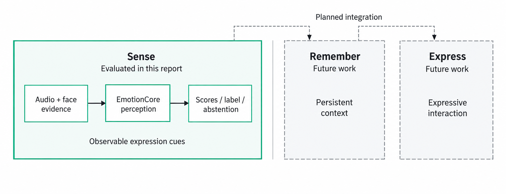
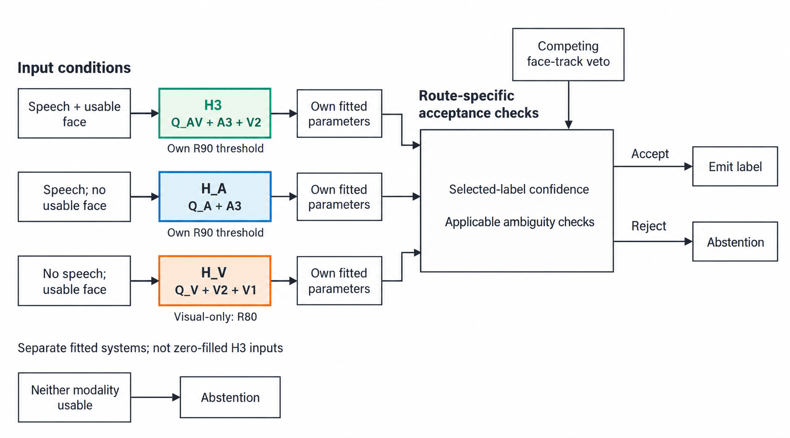
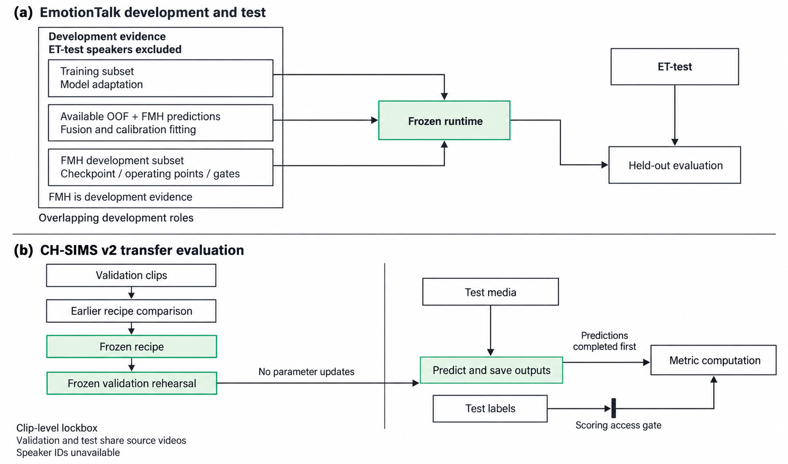
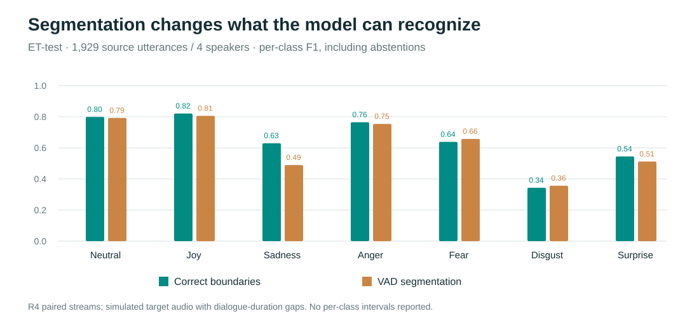
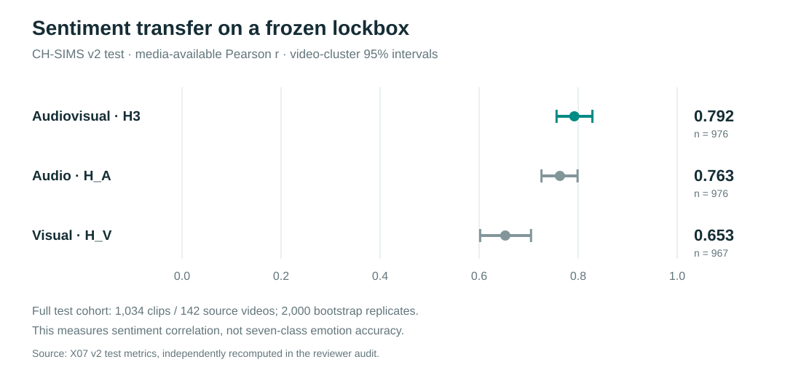
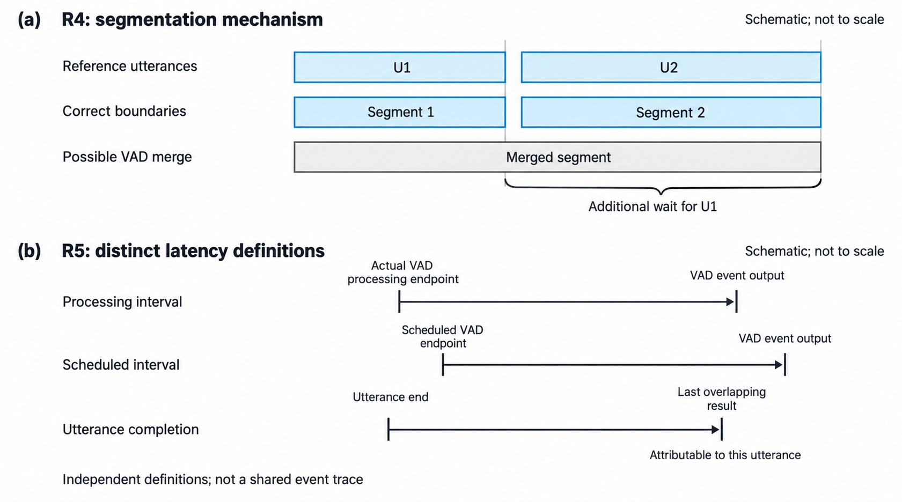

# MundiSense v1
## Chinese Audiovisual Emotion Perception for Single-Person Interaction

**Release technical report · 20 October 2026**

**System snapshot:** H3 / Q_mix / D1_fmhx / calibration bundle v1.1 / X06b runtime.  
**Evidence cutoff:** completed X01–X07 experiments and the 17 October 2026 exploratory reanalysis.  
**Release scope:** technical report and recorded demonstration. Model weights and training data are not distributed with this release.

### Abstract

MundiSense v1 (internal system name: EmotionCore) is a research prototype for recognizing observable emotional expression in Chinese speech and facial video. It combines a task-adapted Qwen2.5-Omni-7B model with a Chinese HuBERT audio expert and a CLIP-based visual expert. A frozen decision layer integrates their probabilities, applies a neutral operating point, and supports abstention and missing-modality routing. The resulting H3 system is intended as a measurable perception component for human-centered interaction. Its outputs describe evidence in a recording; they are not measurements of a person's private mental state.

The current runtime achieves a seven-class macro-F1 of **0.645** on 1,929 EmotionTalk test utterances. With the frozen rejection threshold, macro-F1 is **0.642** with **88.49%** coverage, counting rejections as errors. On a constructed continuous stream with automatic voice activity detection, macro-F1 is **0.624**, compared with **0.649** using correct utterance boundaries on the same stream. On the CH-SIMS v2 test lockbox, the fixed valence projection achieves **Pearson r = 0.792** (95% source-video cluster bootstrap interval: **0.756–0.829**) on 976 media-available clips; non-neutral binary accuracy is **81.89%** over 911 clips, with unavailable media counted as incorrect. These metrics measure different tasks and should not be collapsed into a single accuracy claim.

An approximately three-hour RTX 5090 replay has a backlog P95 of **1.00 s**. Latency depends on the reference point: scheduled VAD endpoint to output is **2.21/2.80 s** at P50/P95, while utterance end to the last attributable result is **3.11/11.02 s** in a short-gap stress stream. The evidence supports controlled demonstrations and recorded-session analysis. Natural-device generalization, reliable silent-expression recognition, and multi-person attribution remain unvalidated. [E01–E05, E12, E13]
<!-- [claim:C001] [evidence:E01,E02,E03,E04,E05,E12,E13] -->

## 1. Motivation and scope

Emotion-aware interfaces need to connect a prediction to the sound, face, and moment that support it. A useful perception component must also expose when these observations are missing or ambiguous. EmotionCore addresses this bounded problem: given one target person's speech and facial video, estimate a distribution over seven expression labels and decide whether the available evidence supports emitting a label. The labels are **neutral, joy, sadness, anger, fear, disgust, and surprise**. The system does not produce a diagnosis, a personality profile, an intent estimate, or an account of a person's internal experience. [E01, E06]
<!-- [claim:C002] [evidence:E01,E06] -->

Mundiscope’s long-term direction is **Sense → Remember → Express**: a reusable emotion-perception module for embodied interaction, with persistent memory and expressive response as later layers. Under the line **“SEE INTO WHAT’S FELT,”** this release addresses the **Sense** layer: making audiovisual emotional cues observable, inspectable, and testable. Memory retrieval, response generation, robot middleware, and embedded-hardware deployment are future integration directions, not capabilities demonstrated here. [E27] The contribution is an implemented and evaluated system assembled from existing foundation models, task adaptation, lightweight experts, and explicit decision rules. It is not a new foundation model trained from scratch. Future interaction capabilities are a research direction, not an outcome established by the experiments in this report.
<!-- [claim:C003] [evidence:E27] -->

Three choices shape the work. First, the multimodal model is complemented by specialist representations, because general audiovisual understanding and targeted emotion features may provide different evidence. Second, classification, abstention, and media availability are measured separately. Third, the study follows the system into a timed input pipeline instead of inferring deployment readiness from clip-level accuracy. [E07–E12]
<!-- [claim:C004] [evidence:E07,E08,E09,E10,E11,E12] -->

The report distinguishes four evidence regimes throughout: speaker-held-out architecture development, a fixed utterance test set, constructed continuous streams, and a clip-level cross-corpus lockbox. The accompanying demo is a curated replay of stored outputs from these experiments. Its examples explain behavior; they do not form a new benchmark. [E02, E06, E07, E13]
<!-- [claim:C005] [evidence:E02,E06,E07,E13] -->

*Figure 1. Mundiscope research scope. The current report evaluates the Sense layer through audiovisual expression evidence, prediction scores, and abstention. Persistent context in Remember and expressive interaction in Express are future research directions. The latter two blocks and their connections denote intended integration, not implemented modules or validated capabilities. [E01, E27, E34]*
<!-- [claim:C006] [evidence:E01,E27,E34] -->

## 2. System architecture

### 2.1 Inputs and expert components

The default full-input system, **H3**, combines three seven-class probability vectors. **Q_AV** is the audio-video branch of Q_mix, a LoRA-adapted Qwen2.5-Omni-7B. **A3** uses the frozen `TencentGameMate/chinese-hubert-large` encoder and a trained temporal attention head. **V2** uses the frozen `openai/clip-vit-large-patch14` visual encoder and a trained temporal attention head. Qwen2.5-Omni supplies the multimodal base, while HuBERT and CLIP supply the specialist representation families; those upstream works establish their methods, not EmotionCore's measured results. [E07–E10; R1–R3]
<!-- [claim:C007] [evidence:E07,E08,E09,E10] -->

For Q, the pipeline prepares eight face-track frames at 336 × 336 pixels together with 16 kHz mono audio. The visual input has no embedded audio track; audio is supplied separately, with modality assertions in preprocessing and forward calls. A fixed prompt requests observable expression. Inference reads the logits of the seven distinct first label tokens and normalizes them, rather than generating free-form explanations and attempting to parse them. This makes the prediction space explicit and reproducible. [E07, E14]
<!-- [claim:C008] [evidence:E07,E14] -->

The expert heads apply layer normalization, temporal attention pooling, and a 256-unit hidden layer with GELU and dropout. A3 additionally learns a weighted mixture of four encoder layers. The cross-corpus head has eight outputs, including MER's `worried` class during training; serving selects and renormalizes the seven EmotionTalk classes. A3 and V2 use frozen backbone features, so the trained heads provide comparatively inexpensive task adaptation. [E15, E29, E30]
<!-- [claim:C009] [evidence:E15,E29,E30] -->

*Figure 2. Default full-input H3 route. Separately supplied audio and face-track frames feed Q_AV, A3, and V2. A frozen decision layer combines their seven-class probabilities, applies the neutral operating point, and either emits a label or abstains. Confidence uses the selected label’s probability before the neutral offset. This is a functional schematic, not a visualization of internal activations; fallback routes are shown separately. [E10, E14, E16, E34]*
<!-- [claim:C010] [evidence:E10,E14,E16,E34] -->

### 2.2 Fusion, calibration, and operating points

For component probabilities \(p_{m,c}\), the fusion layer computes

\[
z_c = \sum_m w_m \log(\max(p_{m,c},10^{-12})) + b_c,\qquad w_m\geq0,\quad \sum_c b_c=0.
\]

Weights and centered class biases are fitted by negative log-likelihood minimization with a small quadratic regularizer. The weights are not constrained to sum to one. In the frozen H3 bundle, the weights for Q_AV, A3, and V2 are approximately **0.5770, 0.3915, and 0.2995**. They describe this fitted log-probability combination, not a causal importance score for each modality. [E10, E17]
<!-- [claim:C011] [evidence:E10,E17] -->

Temperature scaling was selected through held-out development comparisons. The deployed H3 temperature is exactly 1.0 in the saved bundle; the selected method should therefore not be described as proof that this snapshot underwent a nontrivial temperature correction. The fusion bias and weights remain active. [E09, E10]
<!-- [claim:C012] [evidence:E09,E10] -->

**OP-A** uses the calibrated argmax. **OP-N** adds a fixed offset to the neutral log score, chosen to approach a 15% neutral-to-non-neutral error rate on the fitting data. The deployed H3 neutral offset is approximately −0.05949. The emitted label may consequently differ from the largest unadjusted probability. Its confidence is the probability of that selected label **before** the neutral offset is applied. [E09, E10]
<!-- [claim:C013] [evidence:E09,E10] -->

The **R90** threshold is an empirical development-set coverage target. H3 accepts a selected-label confidence of at least **0.4616846**, subject to modality and ambiguity checks. R90 does not mean 90% accuracy, and neither 90% coverage nor calibration is guaranteed after a domain shift. The distinction is visible in the lockbox results. [E09, E10]
<!-- [claim:C014] [evidence:E09,E10] -->

### 2.3 Missing and ambiguous observations

The default route uses H3 when speech and a usable face are present. With speech but no usable face, **H_A** combines Q_A and A3 using its own fitted parameters. Without speech, **H_V** combines Q_V, V2, and V1; V1 is an additional facial-expression expert used by this route. The gate selects R80 for visual-only use, reflecting a separate operating configuration. When neither modality is usable, it abstains. A competing face track whose score reaches at least half the target score triggers ambiguous-multi-face rejection. [E10, E14, E16]
<!-- [claim:C015] [evidence:E10,E14,E16] -->

This face-track rule is a conservative ambiguity check. It is not a speaker identification system or evidence that the visible face is the active speaker. Likewise, no-face fallback should not be confused with visually inferring a missing expression. Missing evidence changes the computational route, and that route is retained with the output. [E01, E16]
<!-- [claim:C016] [evidence:E01,E16] -->

*Figure 3. Logical route selection under missing or ambiguous observations. H3, H_A, and H_V use separately fitted decision parameters. Visual-only operation uses its own R80 configuration. A route-specific acceptance check may abstain, and neither usable modality leads directly to abstention. The schematic summarizes decision logic rather than chronological execution; a competing face-track rule does not establish active-speaker identity. [E09, E10, E14, E16, E34]*
<!-- [claim:C017] [evidence:E09,E10,E14,E16,E34] -->

## 3. Data and development protocol

### 3.1 Cohorts and label alignment

EmotionTalk provides Chinese audiovisual dialogue with categorical and dimensional annotations. The project's primary seven-class target is its multimodal annotation, rather than separately annotated audio, visual, or text labels. The source data card records 19,250 utterances; the official test set has 1,929 utterances from four speakers. The dataset paper describes actor-based dyadic recordings, a distinction that matters when considering spontaneous daily use. [E06, E18; R4]
<!-- [claim:C018] [evidence:E06,E18] -->

| Cohort | Size | Role in this project | Key qualification |
|---|---:|---|---|
| EmotionTalk development pool | 16,366 utterances, 15 speakers | Nested speaker cross-validation | Excludes all four ET-test speakers |
| Final ET training subset | 13,100 utterances, 12 speakers | Final Q and specialist-head training | Excludes FMH speakers as well as test speakers |
| FMH | 3,266 utterances, 3 speakers | Final-model checkpoint subset, operating-point fitting, engineering selection | Development evidence, not an independent test |
| ET-test | 1,929 utterances, 4 speakers | Seven-class evaluation and report-only engineering measurement | Limited speaker diversity |
| MER2026 train, deduplicated | 9,386 clips | Additional Chinese supervision | Six native labels; no speaker IDs |
| MER2026 test | 572 clips | Secondary transfer evaluation | No guaranteed speaker-disjoint split |
| CH-SIMS v2 valid | 647 clips | Earlier recipe comparison and pre-lockbox checks | Development corpus exposure |
| CH-SIMS v2 test | 1,034 clips, 142 source videos | Frozen clip-level lockbox | Not a new-speaker or new-source-video benchmark |

*Table 1. Dataset roles. The rows overlap where explicitly described and must not be summed to obtain a training-set size. [E06, E08–E11, E18–E20]*
<!-- [claim:C019] [evidence:E06,E08,E09,E10,E11,E18,E19,E20] -->

The original ET validation split shares speakers 02 and 13 with ET-test. Later development therefore uses a 15-speaker pool that excludes **02, 13, 20, and 21**, with five frozen outer folds and separate inner validation speakers. This avoids treating the official validation/test pair as speaker-independent. FMH consists of speakers 06, 10, and 11. [E06, E19]
<!-- [claim:C020] [evidence:E06,E19] -->

MER's native vocabulary includes `worried` and does not contain ET's fear and disgust categories. Training uses corpus-specific class masks rather than pretending the two taxonomies are identical. Nine MER training records were removed during deduplication, leaving 9,386. CH-SIMS provides a continuous sentiment target and is not converted into a fabricated seven-class emotion annotation [R8]. No CH-SIMS split was included in project training. [E08, E11, E15, E20]
<!-- [claim:C021] [evidence:E08,E11,E15,E20] -->

### 3.2 Separation of selection and evaluation

Architecture selection in X03 uses speaker-held-out predictions and cross-fitted fusion. X04 evaluates data mixtures, X05 establishes calibration and rejection, and X06 freezes the runtime configuration. The current evidence comes from those staged experiments, not from cherry-picking the strongest historical score. In particular, the X05 clip score of approximately 0.660 is superseded by the current-runtime R3 score of 0.645 for the release headline. [E01, E07–E12]
<!-- [claim:C022] [evidence:E01,E07,E08,E09,E10,E11,E12] -->

For Q_mix, only two outer folds and the final model were trained. A cross-model calibration stopping statistic was withdrawn after review; the revised comparison and the fact that its P1 result was already visible are retained in the experiment record. The recipe decision therefore should not be presented as an entirely untouched preregistration. Q_mix was adopted for a modest transfer benefit, not a large, universal improvement in seven-class recognition. [E08]
<!-- [claim:C023] [evidence:E08] -->

The CH-SIMS test run completed its predictions before the metric stage acquired its label-access lock. A pre-inference label-isolation correction and an initialization failure were preserved in separate records. The later audit independently reconstructed probabilities and metrics from stored component outputs and frozen parameters. However, the lockbox is independent at the **test-clip** level: valid and test share 117 source videos, and 798 test clips come from these shared sources. Speaker IDs are unavailable. These facts limit the interpretation without invalidating the reported frozen clip evaluation. [E03, E11, E21]
<!-- [claim:C024] [evidence:E03,E11,E21] -->

*Figure 4. Summary of development and evaluation roles. The development boxes describe overlapping roles, not disjoint cohorts: fusion/calibration uses available OOF and FMH predictions, while FMH also supports checkpoint and operating-point selection. CH-SIMS validation was exposed during earlier recipe comparison and later frozen rehearsal; the retained label-isolation correction is described in the report. Test prediction precedes label-dependent scoring. The lockbox is clip-level, with shared validation/test source videos and unavailable speaker IDs; this is not a pristine preregistration claim. [E06, E09, E11, E19, E21, E34]*
<!-- [claim:C025] [evidence:E06,E09,E11,E19,E21,E34] -->

## 4. Training and adaptation

### 4.1 Q_mix recipe

Q_mix starts from the quantized Qwen2.5-Omni-7B base, rather than continuing an earlier EmotionCore adapter. Its adaptation uses NF4 double quantization and BF16 computation, with LoRA on language-model attention and visual blocks while the audio tower remains frozen. The method follows the general low-rank adaptation and quantized fine-tuning approaches of LoRA and QLoRA, with project-specific choices below. [E07, E08, E22; R5, R6]
<!-- [claim:C026] [evidence:E07,E08,E22] -->

| Setting | Final Q_mix configuration |
|---|---|
| Language adapter | Rank 16, alpha 32, dropout 0.05 |
| Visual adapter | Rank 8, alpha 16; learning rate 0.2 × language rate |
| Optimizer | AdamW; weight decay 0.01 |
| Language learning rate | 5 × 10⁻⁵ |
| Schedule | Cosine decay; 5% warmup |
| Effective batch | 8 |
| Training duration | 2 epochs |
| Per-epoch data | All 13,100 final ET records + 4,693 stratified MER records |
| Total sample presentations | 35,586 |
| Assigned input forms | Approximately 60% AV, 20% A, 20% V; missing-face fallback to A |
| Checkpoint selection | Fixed 700-item ET inner-validation subset, every quarter epoch |
| Selected checkpoint | `best_adapter_eval8` |

*Table 2. Final training recipe. Counts refer to sample presentations when a record is seen more than once. [E07, E08, E22, E31, E32]*
<!-- [claim:C027] [evidence:E07,E08,E22,E31,E32] -->

ET examples retain the original target-token loss. For MER examples, the first label-token loss is restricted to the six native MER classes; remaining target tokens use the ordinary vocabulary cross-entropy, averaged over target tokens. The recorded final run contains 7,258 A, 7,085 V, and 21,243 AV presentations, including 140 face-missing fallbacks. It records no OOM-skipped training examples, a peak allocated GPU memory of 13.730 GiB, and approximately 17.99 hours for the final training process. These are run receipts, not a total end-to-end project cost. [E08, E22]
<!-- [claim:C028] [evidence:E08,E22] -->

### 4.2 Specialist adaptation and final fitting

The deployed D1_fmhx expert heads are trained on 13,100 ET records and all 9,386 retained MER records. A3, V2, and V1 use fixed training durations of 6, 12, and 4 epochs respectively, with FMH excluded. This correction matters: earlier D1 final heads had already used FMH, so they could not support a clean FMH calibration analysis. The repaired deployment heads and the original out-of-fold expert predictions serve different purposes and are not substituted for one another. [E09]
<!-- [claim:C029] [evidence:E09] -->

Fusion and calibration use 6,533 two-fold out-of-fold examples plus 3,266 FMH examples, for 9,799 records across nine speakers. Neutral bias and rejection thresholds use FMH only. No test-set threshold fitting is performed. This is a calibrated ensemble with a frozen operating policy; it is not a fully end-to-end trained streaming model. [E09, E10]
<!-- [claim:C030] [evidence:E09,E10] -->

### 4.3 Architecture evidence

The earlier X03 comparison isolates the motivation for combining Q and specialist evidence. It uses the same development regime for the candidate systems. [E07]
<!-- [claim:C031] [evidence:E07] -->

| X03 system | Cross-validated OP-N macro-F1 |
|---|---:|
| Best specialist ensemble, including text | 0.6309 |
| Q_AV alone | 0.6330 |
| H3: Q_AV + A3 + V2 | 0.6517 |
| H_ref: Q_A + Q_AV + A3 + V2 + V1 | 0.6547 |

*Table 3. Historical architecture-selection evidence. These are development results for the earlier Q_et configuration, not current release test scores. The best H arm improves over the best specialist arm by 0.0238, with a 95% speaker-cluster bootstrap interval of 0.0118–0.0410. H3 approaches H_ref while avoiding an additional Q forward pass on full-input speech. [E07, E12]*
<!-- [claim:C032] [evidence:E07,E12] -->

## 5. Evaluation and results

### 5.1 Metric definitions

Seven-class macro-F1 averages class F1 equally. Rejected or unavailable inputs remain in the relevant recall denominator; accepted-only results are labeled separately. Coverage is the fraction of the full input cohort that receives an accepted output. Neutral false-positive rate is the fraction of true-neutral utterances accepted with a non-neutral label in the R4 reporting convention. These quantities answer different questions about discrimination, willingness to answer, and unwanted non-neutral output. [E06, E02]
<!-- [claim:C033] [evidence:E02,E06] -->

For CH-SIMS, the frozen projection is

\[
s = P(joy)-P(anger)-P(disgust)-P(fear)-P(sadness).
\]

Pearson and Spearman correlations compare this score with the continuous annotation. Acc-2 compares signs after excluding **ground-truth zero** labels. Unavailable media are retained as incorrect for Acc-2. The projection is not an absolute intensity scale: a uniform seven-class vector yields −3/7, not zero. The report therefore distinguishes media-available correlation from the auxiliary all-input correlation that includes uniform fallback probabilities. [E06, E11]
<!-- [claim:C034] [evidence:E06,E11] -->

### 5.2 Current seven-class performance

| Current-runtime condition | Seven-class macro-F1 | Accepted coverage | Interpretation |
|---|---:|---:|---|
| R3, correct clips, OP-N | 0.6451 | No R90 rejection applied | Clip diagnostic; modality and multi-face gates disabled |
| R3, correct clips, R90 | 0.6418 | 88.49% | Same diagnostic; rejection counts as error |
| R4, correct boundaries on constructed stream | 0.6487 | 89.01% | Full frozen routing and rejection |
| R4, automatic VAD on the same stream | 0.6240 | 87.66% | Segmentation-inclusive result |

*Table 4. All rows use 1,929 ET-test utterances. R3 and R4 are different constructions and gate conditions; their small score differences are not a controlled estimate of segmentation alone. The controlled R4 difference is −0.0247. [E02, E04, E05]*
<!-- [claim:C035] [evidence:E02,E04,E05] -->

R4 preserves target-person dialogue timing using the durations of intervening turns and registered pauses. Other speakers' media are not rendered or inferred; the simulation assumes their voices do not enter the target microphone. It is a target-person stream proxy, not a recording of a complete multi-person conversation. Under automatic VAD, 1,270 utterances are one-to-one matches, 297 are merged only, 235 are split only, and 127 are both merged and split. All source utterances retain some overlap coverage. [E02, E05]
<!-- [claim:C036] [evidence:E02,E05] -->

*Figure 5. ET-test per-class F1 on the same R4 constructed stream, with correct boundaries and automatic VAD. Rejections remain in the denominator. The figure is generated directly from the saved R4 result JSON; it does not depict uncertainty intervals that were not reported. [E05]*
<!-- [claim:C037] [evidence:E05] -->

| Class | Test support | Correct-boundary F1 | Automatic-VAD F1 |
|---|---:|---:|---:|
| Neutral | 801 | 0.799 | 0.792 |
| Joy | 246 | 0.821 | 0.806 |
| Sadness | 123 | 0.630 | 0.490 |
| Anger | 339 | 0.765 | 0.754 |
| Fear | 125 | 0.638 | 0.658 |
| Disgust | 134 | 0.343 | 0.356 |
| Surprise | 161 | 0.545 | 0.512 |

*Table 5. Performance is uneven across labels. The four-speaker test set limits population-level inference. [E05, E18]*
<!-- [claim:C038] [evidence:E05,E18] -->

The largest class-level segmentation loss is sadness. The 17 October reanalysis finds sadness precision of 68.1% and recall of 38.2% under R4 VAD: 47 of 123 sadness utterances are detected, while 47 of 69 sadness outputs are correct. Correct boundaries recover 74 of the 123 sadness utterances. Joy has precision/recall of 83.8%/77.6%, and anger 76.2%/74.6%. This points to missed detections as an important part of the sadness deficit; it does not show that all error is attributable to VAD. [E23]
<!-- [claim:C039] [evidence:E23] -->

The faster face pipeline also entails a measurable tradeoff. Against the previous R3 pipeline, ET-test OP-N F1 changes by −0.0109, with a paired utterance-bootstrap interval of −0.0206 to −0.0021. The development-set non-inferiority requirement was met, but the test-set reduction remains part of the result. The release does not replace this value with a higher historical score. [E02, E04, E12]
<!-- [claim:C040] [evidence:E02,E04,E12] -->

### 5.3 Cross-corpus lockbox

*Figure 6. Media-available Pearson correlation on CH-SIMS v2 test. H3 and H_A use 976 clips; H_V uses 967, because nine otherwise available clips have no usable face for the visual-only route. Error bars are the retained 95% source-video cluster bootstrap intervals. The H3 versus H_A paired comparison uses the same 976 clips. [E03, E24]*
<!-- [claim:C041] [evidence:E03,E24] -->

| CH-SIMS v2 test measure | H3 | Denominator / scope |
|---|---:|---|
| Pearson r | **0.7923** [0.7564, 0.8287] | 976 media-available clips |
| Spearman ρ | 0.8016 [0.7663, 0.8344] | Same media-available clips |
| Non-neutral Acc-2 | **81.89%** [78.37%, 85.09%] | 911 nonzero ground-truth clips; media failures count as errors |
| All-input Pearson r | 0.7613 [0.7216, 0.7994] | 1,034 clips; unavailable inputs use frozen fallback |
| R90 accepted coverage | **62.38%** [56.24%, 68.14%] | 645 accepted / 1,034 total |
| Accepted-only Pearson r | 0.8100 [0.7679, 0.8525] | 645 accepted clips |

*Table 6. Intervals use 2,000 bootstrap replicates resampling whole source videos. Full source-video clusters are sampled before each metric's availability or label filter is applied. The task is sentiment transfer, not seven-class classification. [E03, E11, E24]*
<!-- [claim:C042] [evidence:E03,E11,E24] -->

The 1,034 inputs separate into 645 accepted, 257 rejected for ambiguous multiple faces, 74 rejected for low confidence, and 58 unavailable media. Among the 719 media-available inputs without the ambiguous-face flag, 645 are accepted, giving 89.71% coverage. This subset is a useful explanation of the global drop but is not a human-verified single-person benchmark. The headline denominator remains 1,034. [E03]
<!-- [claim:C043] [evidence:E03] -->

On the same 976 available clips as H3, H_A obtains Pearson 0.7631. H_V obtains 0.6528 on its 967 available clips; this visual-only value has a different availability denominator. A later explanatory paired analysis gives H3 − H_A = 0.0291, with a 95% source-video cluster interval of 0.0015–0.0570. This comparison supports retaining audiovisual evidence in the present system, while its retrospective status and shared-source limitation remain explicit. [E03, E24]
<!-- [claim:C044] [evidence:E03,E24] -->

### 5.4 Exploratory coarse outputs

The 17 October analysis remaps the existing decisions: joy becomes positive; sadness, anger, fear, and disgust become negative; neutral remains neutral; surprise becomes unknown; rejection remains rejection. It neither retrains a three-class model nor re-estimates probabilities or thresholds. Across all 1,929 source utterances, macro-F1 over the three defined categories is 0.783 with automatic VAD, compared with 0.796 using correct boundaries. The 161 ground-truth surprise examples are retained when calculating false positives, and unknown/rejected outputs count as misses for defined-class truth. [E23]
<!-- [claim:C045] [evidence:E23] -->

The same analysis explores high absolute annotated valence, using |v| ≥ 1.5 as a proxy. Its three-emotion strong-valence subset yields 100 correct outputs out of 111, but 95 of those 111 examples are anger, 13 sadness, and only 3 joy. This is a small, imbalanced, post hoc subgroup. It does not justify a headline such as “90% recognition of strong emotions,” and annotated valence strength is not equivalent to facial exaggeration or arousal. [E23]
<!-- [claim:C046] [evidence:E23] -->

## 6. Continuous processing and runtime

### 6.1 Streaming pipeline

The X06b pipeline processes frames sequentially at a global 5 fps sampling grid. YuNet detects faces at half input resolution; boxes map back to the original frame for cropping. Eight independent detector instances and at most 16 frames in flight bound preprocessing concurrency. Tracking and crop preparation run incrementally during the speech segment. FSMN VAD uses a frozen threshold of 0.3 and minimum silence of 0.4 s. Temporal smoothing is disabled. [E02, E12]
<!-- [claim:C047] [evidence:E02,E12] -->

The engineering objective is sustained throughput with bounded backlog. It should not be confused with subsecond response time. Even when processing keeps pace with the incoming stream, the system must wait for the output unit to close and then finish inference. R4 measures segmentation effects on a dialogue-timed proxy; R5 measures timing on the older short-gap stress construction. These are distinct tests, not one combined natural-stream benchmark. [E02, E13]
<!-- [claim:C048] [evidence:E02,E13] -->

*Figure 7. Schematic illustration of segmentation and timing definitions, not measured traces. Panel (a) explains the segmentation mechanism relevant to the R4 comparison; panel (b) defines the three separate R5 timing quantities. The first two end at a VAD event output, whereas utterance completion ends at the last overlapping result attributable to that utterance. The independent timelines are not one aligned observation, do not depict first feedback, and do not encode measured durations. Reported P50/P95 values remain in Table 7. [E02, E13, E34]*
<!-- [claim:C049] [evidence:E02,E13,E34] -->

### 6.2 Runtime measurements

R5 replays 10,755.08 seconds of media on an RTX 5090 32 GB workstation with approximately 94 GB of host memory. It produces 1,933 events, including 1,900 speech events and 33 silent events. The full wall time is 10,766.42 seconds, a ratio of 1.001054 after draining the final outputs. Backlog P95 is 0.998 s, with no increase from the first half to the second half of the replay. [E02, E13]
<!-- [claim:C050] [evidence:E02,E13] -->

| R5 timing definition | P50 | P95 | What the clock measures |
|---|---:|---:|---|
| Actual VAD processing endpoint → output | 1.66 s | 1.87 s | Consumer-side processing interval |
| Scheduled VAD endpoint → output | 2.21 s | 2.80 s | Includes input scheduling / backlog |
| Ground-truth utterance end → last overlapping result | 3.11 s | 11.02 s | Completion of all results attributable to that utterance |
| Same completion metric, one-to-one utterances only | 2.85 s | 3.51 s | 811 utterances with no merging or splitting |

*Table 7. Quantiles with different origins are not interchangeable. The last two rows measure completion, not the first feedback visible to a user. Quantiles of individual latency components cannot simply be added. [E02, E13]*
<!-- [claim:C051] [evidence:E02,E13] -->

All 417 utterances with completion waits longer than 5 s and all 129 longer than 10 s involve merging. A merged VAD segment may keep an earlier utterance waiting until later speech ends. This is evidence for investigating output units and endpoints before assuming that a larger or faster classifier is the main missing ingredient. [E13]
<!-- [claim:C052] [evidence:E13] -->

Process RSS grows from 4.851 GiB at the first sample after 10 minutes to 5.386 GiB at the end, with a post-10-minute peak of 5.737 GiB. The 11.04% endpoint growth misses the original <10% criterion; the reviewer accepted it as a recorded limitation. The planned endpoint latency also misses the original 1.5/2.5 s P50/P95 targets. The near-unity wall-time ratio was accepted because the definition includes final draining. These review decisions do not erase the measured misses or establish stability beyond the observed run. [E02, E12]
<!-- [claim:C053] [evidence:E02,E12] -->

## 7. Demonstration design

The released MundiSense v1 video is a **104.167-second edited replay of eight saved examples**, rendered at 1920 × 1080 and 30 fps with original source audio. Six EmotionTalk cases illustrate accepted neutral, joy, sadness, anger, fear, and surprise decisions. Two CH-SIMS v2 film clips then illustrate complementary audiovisual evidence and ambiguous-multi-face rejection. These are purposefully selected explanatory cases, not a random performance sample. No demo-set accuracy is reported. [E28, E33, E35]
<!-- [claim:C054] [evidence:E28,E33,E35] -->

The presentation uses a three-dimensional schematic of the audio, visual, and audiovisual branches, with sequentially revealed saved module scores and a final decision. Node placement, topology, layer counts, camera movement, flow animation, and reveal times are presentation devices. They are **not internal neural activations or measured model-output timestamps**. Recorded module durations are shown where available, but the subtotal of audio decoding, A3, V2, and Q_AV excludes face preprocessing and stream waiting. It is not end-to-end latency. Formal latency results remain those in Section 6. [E28, E35]
<!-- [claim:C055] [evidence:E28,E35] -->

In the audiovisual-complementarity example, H_A has sentiment −0.58, H_V +0.46, and H3 +0.29 against a CH-SIMS annotation of +0.40. A3 is an individual expert; it must not be conflated with the H_A fused system. In the ambiguity example, the pre-gate candidate is neutral with confidence approximately 0.915, but the final output is rejection. The high candidate score is never presented as an accepted prediction. CH-SIMS supplies sentiment ground truth, so neither film clip is given a fabricated seven-class correctness label. [E28, E35]
<!-- [claim:C056] [evidence:E28,E35] -->

The landscape film clips retain their full aspect ratio, including the competing face. Source playback and original audio are followed by a visibly labeled end-of-clip hold while saved results remain visible. Reveal timing is editorial. The final EmotionTalk result panel refers to the complete 1,929-utterance R4 correct-boundary evaluation, rather than the eight selected cases. The video does not measure continuous-stream response time. [E28, E35]
<!-- [claim:C057] [evidence:E28,E35] -->

The production records retain the eight source identities, probabilities, component durations, and edit timeline. The final validation confirms matched saved records, a successful complete decode, 3,125 video frames, a 104.166667-second container duration, and an audio track. These checks validate the exported file and transcription of existing results; they do not independently reannotate emotion or constitute a new model evaluation. [E28, E33]
<!-- [claim:C058] [evidence:E28,E33] -->

## 8. Limitations and intended use

**Population and domain coverage.** ET-test contains only four speakers. CH-SIMS is a clip-level transfer test with shared development/test source videos and no speaker IDs. Neither result establishes broad generalization to new users, accents, microphones, lighting, or camera placement. The base models' complete pretraining overlap with these evaluation materials is not established by the project-level training audit. [E01, E03, E18, E21]
<!-- [claim:C059] [evidence:E01,E03,E18,E21] -->

**Observable expression and label ambiguity.** The target is the dataset's annotation of audiovisual expression. Human annotations differ across modalities; a visible or audible cue does not uniquely determine internal emotion. Outputs should remain revisable observations associated with media and time, with uncertainty preserved. [E18]
<!-- [claim:C060] [evidence:E18] -->

**Segmentation and attribution.** Constructed streams omit other speakers' incoming audio and cannot establish behavior in real overlapping conversation. The face gate detects competing tracks but does not bind a voice to a verified identity. Multi-person interaction, active-speaker attribution, and continuous natural-device use remain outside this release's demonstrated scope. [E01, E02, E16]
<!-- [claim:C061] [evidence:E01,E02,E16] -->

**Visual-only and silent states.** The earlier X05 H_V seven-class test F1 is approximately 0.367, substantially below audiovisual H3. R5 includes only 33 silent events and uses last-frame holding in synthetic gaps. These are pipeline checks, not evidence of reliable natural silent-expression recognition. [E01, E09, E13]
<!-- [claim:C062] [evidence:E01,E09,E13] -->

**Calibration and coverage shift.** R90 is a fitted threshold, not a guarantee. Multi-face rejection, media failure, and low confidence have separate causes. Reporting only accepted examples can conceal the cost of abstention; reporting only global coverage can conceal which input conditions caused it. [E03, E09]
<!-- [claim:C063] [evidence:E03,E09] -->

**Engineering and reproducibility.** The measured hardware is a workstation. Mobile performance, CPU-only inference, arbitrary uploaded-file support, six-hour stability, and a public camera service are not established. Early X01 receipts also record a dirty working tree without a runtime diff; the original exact uncommitted execution state cannot be reconstructed solely from Git. Later frozen configurations and audited result hashes improve traceability but do not retroactively remove that historical limitation. [E01, E02, E26]
<!-- [claim:C064] [evidence:E01,E02,E26] -->

The supported use is controlled research demonstration, assisted annotation, and retrospective inspection of recordings where a person can review both the media and uncertainty. Broader Mundiscope applications require evaluation for their own interaction context. The present prototype does not establish clinical, employment, educational assessment, or other consequential decision validity.

## 9. Reproducibility and release status

This report introduces no new training, inference, threshold optimization, or formal benchmark. Its tables and two data plots transcribe retained reports and structured result files. Five additional diagrams supplied by the project owner illustrate the architecture, routing, protocol, timing definitions, and research scope; their original pixels are preserved. These schematics do not add experimental evidence. The companion `source_manifest.json` records source identifiers, project-relative locations, file hashes, and source locators. `claims.csv` binds the report sections to evidence. `evidence_ledger.md` provides a readable index. The evidence record distinguishes automated source inspection from independent human scientific verification; no unperformed verification is claimed.

The frozen Q_mix adapter hash is `67c5d689952fe78b736dc628c7ddf7d883203b00ad4d3361e22260fe3c0794f3`. A3 and V2 deployment heads and the calibration bundle are separately identified in the source manifest. The current runtime explicitly defaults to H3 through the serving interface and gate configuration; an older top-level `default_full_system: H_ref` field remains in the bundle, so consumers should use the documented serving route rather than inferring a runtime choice from that field alone. [E10, E14]
<!-- [claim:C065] [evidence:E10,E14] -->

This release contains the technical report and recorded demonstration; it does not distribute model weights or training datasets. Upstream model, dataset, and source-media rights remain separate from the report. The retained MER data card documents restrictions on commercial use and redistribution; publishing a technical description does not grant additional rights to those materials. [E20]
<!-- [claim:C066] [evidence:E20] -->

AI assistance was used to inspect local experiment records, draft this report, and prepare its evidence index. The scientific-writing workflow from Scientific Agent Skills informed provenance handling and separation of drafting from approval [R7]. AI assistance does not constitute authorship or independent validation of the scientific results.

## 10. Conclusion

EmotionCore establishes a concrete first perception component for Mundiscope: Chinese audiovisual expression recognition with complementary experts, explicit uncertainty, and timed processing. The current evidence shows useful signal at the utterance level, modest degradation from automatic segmentation, and cross-corpus sentiment transfer under a frozen protocol. It also makes the remaining gaps measurable: uneven fine-grained recognition, merge-driven waiting, limited speaker coverage, and uncertain performance on natural devices. The release presents an inspectable research prototype, with broader interaction claims reserved for future evidence.

## References

**R1.** Xu, J., et al. (2025). *Qwen2.5-Omni Technical Report*. [arXiv:2503.20215](https://arxiv.org/abs/2503.20215).

**R2.** Hsu, W.-N., Bolte, B., Tsai, Y.-H. H., Lakhotia, K., Salakhutdinov, R., and Mohamed, A. (2021). *HuBERT: Self-Supervised Speech Representation Learning by Masked Prediction of Hidden Units*. [arXiv:2106.07447](https://arxiv.org/abs/2106.07447).

**R3.** Radford, A., et al. (2021). *Learning Transferable Visual Models From Natural Language Supervision*. [arXiv:2103.00020](https://arxiv.org/abs/2103.00020).

**R4.** Sun, H., et al. (2025). *EmotionTalk: An Interactive Chinese Multimodal Emotion Dataset With Rich Annotations*. [arXiv:2505.23018](https://arxiv.org/abs/2505.23018). This report cites the opened preprint record.

**R5.** Hu, E. J., et al. (2021). *LoRA: Low-Rank Adaptation of Large Language Models*. [arXiv:2106.09685](https://arxiv.org/abs/2106.09685).

**R6.** Dettmers, T., Pagnoni, A., Holtzman, A., and Zettlemoyer, L. (2023). *QLoRA: Efficient Finetuning of Quantized LLMs*. [arXiv:2305.14314](https://arxiv.org/abs/2305.14314).

**R7.** Kassis, T., Agarwal, V., He, Y., Patel, D., and Brueckner, A. M. (2026). *Scientific Agent Skills: A Library of Procedural Knowledge for Research Agents*. [arXiv:2609.00065](https://arxiv.org/abs/2609.00065). Current record checked 19 October 2026; v2. Procedural writing assistance, not evidence for model performance.

**R8.** Liu, Y., et al. (2022). *Make Acoustic and Visual Cues Matter: CH-SIMS v2.0 Dataset and AV-Mixup Consistent Module*. [arXiv:2209.02604](https://arxiv.org/abs/2209.02604), accepted at ICMI 2022. CH-SIMS is used here for its sentiment task; this report does not compare against the paper's model under an identical experimental setup.

All external reference pages above were opened on 19 October 2026. The model's own results derive from the local evidence ledger, not from these references.
